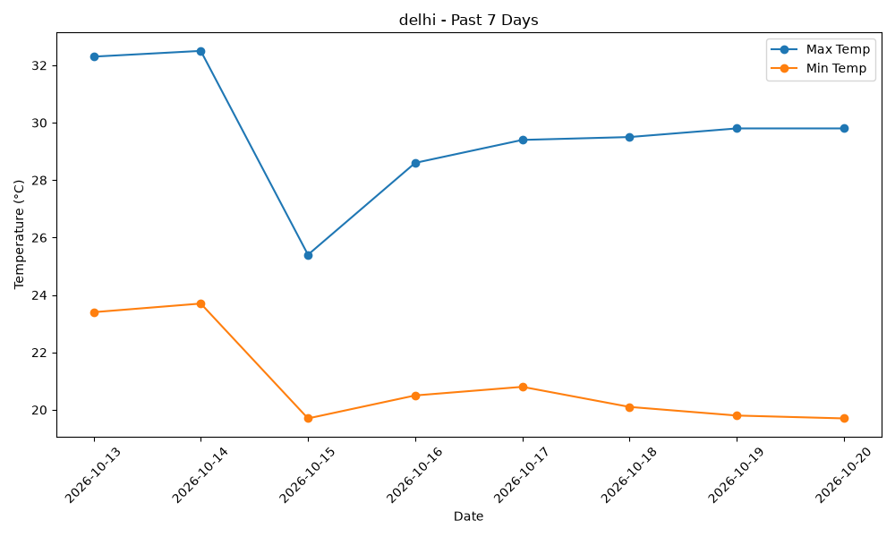
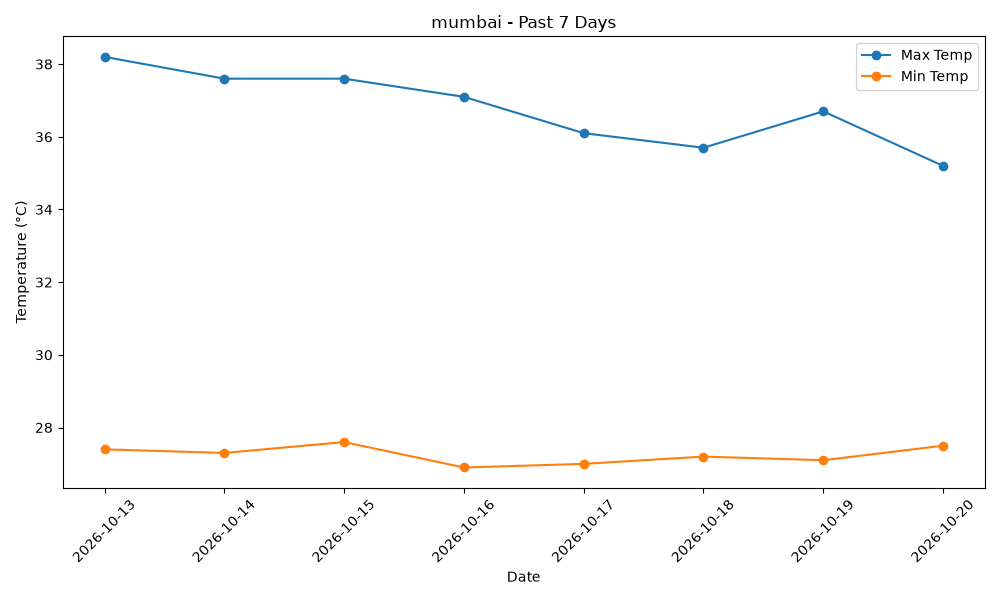

<div align="center">

# 🌦️ Weather Forecasting

**Type a city. Get the last week's temperatures as a table, a chart, and a CSV.**


</div>

---

## ✨ Features

- 🔎 **City search**: enter any city name and it is converted to latitude and longitude automatically
- 🌡️ **Past 7 days of weather**: daily max and min temperature in °C
- 📊 **Graphs and charts**: a clean line chart of max vs. min temperature, saved as a PNG
- 📁 **CSV export**: the data is saved as a `.csv` file you can open in Excel or reuse elsewhere
- 🔑 **No API key needed**: uses the free [Open-Meteo](https://open-meteo.com/) APIs

---

## 📸 Examples

<table>
  <tr>
    <th align="center">Delhi</th>
    <th align="center">Mumbai</th>
  </tr>
  <tr>
    <td></td>
    <td></td>
  </tr>
  <tr>
    <td align="left"><a href="data/Delhi_weather.csv">📄 Delhi_weather.csv</a></td>
    <td align="right"><a href="data/Mumbai_weather.csv">📄 Mumbai_weather.csv</a></td>
  </tr>
</table>

**Sample output (Delhi):**

| date       | max_temp | min_temp |
|------------|----------|----------|
| 2026-10-13 | 32.3     | 23.4     |
| 2026-10-14 | 32.5     | 23.7     |
| 2026-10-15 | 25.4     | 19.7     |
| 2026-10-16 | 28.6     | 20.5     |
| 2026-10-17 | 29.4     | 20.8     |
| 2026-10-18 | 29.5     | 20.1     |
| 2026-10-19 | 29.8     | 19.8     |
| 2026-10-20 | 29.8     | 19.7     |

**Sample output (Mumbai):**

| date       | max_temp | min_temp |
|------------|----------|----------|
| 2026-10-13 | 38.2     | 27.4     |
| 2026-10-14 | 37.6     | 27.3     |
| 2026-10-15 | 37.6     | 27.6     |
| 2026-10-16 | 37.1     | 26.9     |
| 2026-10-17 | 36.1     | 27.0     |
| 2026-10-18 | 35.7     | 27.2     |
| 2026-10-19 | 36.7     | 27.1     |
| 2026-10-20 | 35.2     | 27.5     |

---

## 🚀 Getting Started

**1. Clone the repo**

```bash
git clone https://github.com/<your-username>/weather-forecasting.git
cd weather-forecasting
```

**2. Install the libraries**

```bash
pip install requests pandas matplotlib
```

**3. Run it**

```bash
python weather.py
```

Then type a city name when asked:

```
Enter city name: Delhi
```

---

## 📂 What You Get

After each run, the script creates:

```
weather-forecasting/
├── weather.py
├── <city>_chart.png        # temperature chart
└── data/
    └── <city>_weather.csv  # date, max_temp, min_temp
```

---

## 🛠️ How It Works

1. Takes the city name you type
2. Looks up its coordinates with the Open-Meteo Geocoding API
3. Fetches daily max/min temperatures for the past week from the Open-Meteo Weather API
4. Builds a Pandas DataFrame, plots it with Matplotlib, and saves the chart and CSV

---

## 📝 Notes

- If a city name is shared by several places (e.g. Paris), the top search match is used.
- If the city isn't found, the script prints a message and exits.

---

<div align="center">

Made with Python 🐍 · Weather data by [Open-Meteo](https://open-meteo.com/)

</div>
